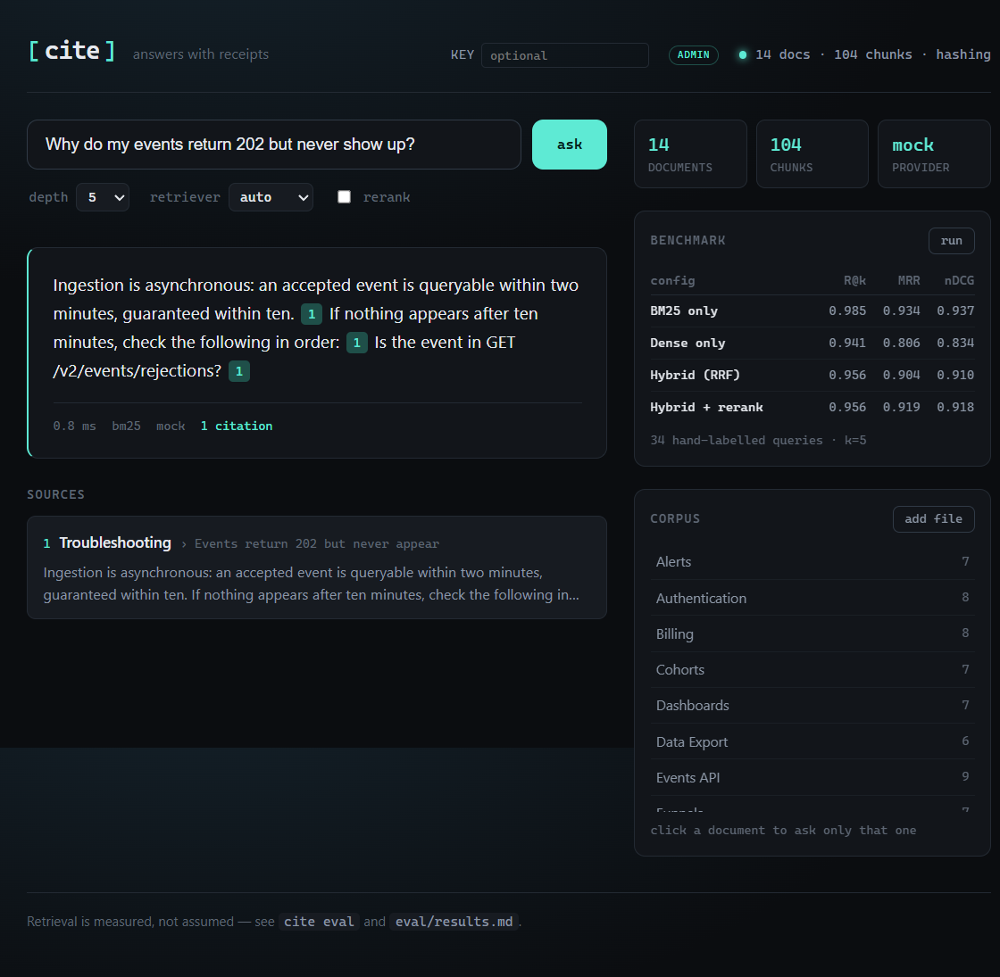

# cite

**Grounded answers over your own documents, with a retrieval benchmark that runs in one command.**

Most RAG projects demo an answer and stop. `cite` treats retrieval as a measurable
system: it ships a hand-labelled golden set, an ablation harness, and the numbers those
produce — including the results that did not go the way the project expected.

```bash
pip install -e ".[dev]"
cite ingest --corpus data/corpus
cite eval
```

No API keys. No network. No GPU. The default embedder is a deterministic feature-hashing
model, so the benchmark is reproducible on any laptop. Swapping in a hosted embedding
model and an LLM is one environment variable.



---

## Headline result

34 hand-labelled queries over a 14-document technical handbook, k = 5:

| Configuration | Recall@5 | MRR | nDCG@5 | p50 (ms) | p95 (ms) |
|---|---:|---:|---:|---:|---:|
| BM25 only | **0.985** | **0.934** | **0.937** | **0.04** | **0.05** |
| Dense only | 0.941 | 0.806 | 0.834 | 3.34 | 3.72 |
| Hybrid (RRF) | 0.956 | 0.904 | 0.910 | 3.56 | 3.77 |
| Hybrid + rerank | 0.956 | 0.919 | 0.918 | 3.99 | 4.42 |

*`hashing` embedder, single core, measured with `cite eval`. Reproduce with `cite eval --out eval/results.md`.*

### The finding that matters

**The hybrid retriever did not beat BM25.** That is not the story the project set out to
tell, and it is the most useful thing in this repository.

The cause is visible in the ablation: dense retrieval alone loses 5 points of recall and
13 points of MRR against a 30-year-old lexical algorithm. The offline embedder is
*lexical* — it hashes word, bigram, and character n-gram features. Fusing a weak lexical
model with a strong lexical model does not add a second signal; it adds noise, and RRF
duly dilutes a correct rank-1 result.

Two changes followed from measuring instead of assuming:

1. `mode=auto` now selects BM25 for lexical embedders and hybrid only for a semantic
   embedder (`CITE_EMBEDDER=openai`). The product does not ship the configuration its own
   benchmark rejects.
2. The heuristic reranker is off by default. It recovers a little MRR (+0.015) but does
   not beat plain BM25, costs ~12% latency, and adds a component that has to be
   maintained. It stays in the repo as an ablation and as the interface a real
   cross-encoder would implement.

Deleting a component that does not pay for itself is a result. Shipping it anyway is
how systems rot.

---

## What it actually does

```
                 ┌──────────────┐
  Markdown  ────▶│  chunker     │  heading-aware, block-aware
  corpus         │              │  (bullets, tables, code stay intact)
                 └──────┬───────┘
                        │ chunks + heading breadcrumbs
                 ┌──────▼───────┐
                 │    index     │
                 │  ┌────────┐  │  BM25: inverted index, postings-only scoring
                 │  │  bm25  │  │
                 │  ├────────┤  │  dense: cosine over normalised vectors
                 │  │ dense  │  │
                 │  └────┬───┘  │
                 └───────┼──────┘
                         │  RRF fusion (optional) → heuristic rerank (optional)
                 ┌───────▼──────┐
  question ─────▶│  retriever   │──▶ top-k chunks
                 └───────┬──────┘
                 ┌───────▼──────┐
                 │  provider    │  mock (extractive, default) | OpenAI | Anthropic
                 └───────┬──────┘
                 ┌───────▼──────┐
                 │  citations   │  [n] markers → source, heading, snippet
                 └──────────────┘
```

Every answer carries citations resolved back to the exact chunk, so a wrong answer is
auditable rather than mysterious.

### The chunker

Chunking is where most RAG quality is won or lost, so it is not a `text.split()`:

- **Headings first.** A chunk never spans two topics. The heading breadcrumb
  (`API > Rate limits`) is prepended to the *indexed* text so short sections are
  findable, but kept out of the *displayed* body so citations read cleanly.
- **Blocks, not characters.** Wrapped prose is joined into paragraphs; each list item,
  table row, and fenced code block stays intact and separately citable.
- **Stable ids.** Chunk ids are content hashes. Re-ingesting the same corpus produces the
  same index, which makes diffs and caching meaningful.

### The evaluator

- Metrics: recall@k, MRR, nDCG@k — computed at **document** level, because a user cares
  whether the right page was found, not which slice of it.
- Relevance judgements are hand-written, not generated by the retriever. A golden set
  produced by the system under test measures nothing.
- Ablations are declarative: add a `(name, mode, rerank)` tuple and it appears in the table.

---

## Quickstart

```bash
python -m venv .venv
# Windows: .\.venv\Scripts\activate
source .venv/bin/activate
pip install -e ".[dev]"

cite ingest --corpus data/corpus          # 14 docs → 104 chunks
cite ask "How many tiles can a dashboard have?"
cite eval                                  # ablations → Markdown table
cite serve                                 # API + UI on http://127.0.0.1:8000
```

Example:

```
$ cite ask "Why do my events return 202 but never show up?"

A 202 means the batch was queued, not that it is queryable yet. [1]
Ingestion is asynchronous: an accepted event is queryable within two minutes,
guaranteed within ten. [1]

Sources
  [1] Quickstart > 3. Send a first event

0.4 ms | bm25 | mock
```

### Using a real model

```bash
export OPENAI_API_KEY=sk-...
cite --embedder openai ingest --corpus data/corpus
cite --embedder openai ask "..." --provider openai
```

The provider interface is one method (`generate(question, contexts)`), so adding a new
backend is a class, not a refactor. `mode=auto` switches to hybrid retrieval as soon as
the embedder is semantic.

### Using your own documents

The demo answers from `data/corpus/` — 14 synthetic Markdown pages for a fictional
product, written for this project. Point the ingester at any folder to replace them:

```bash
cite ingest --corpus "$HOME/handbook" --out data/index.json
cite serve
```

- Supported files: `.md`, `.markdown`, `.txt`; subdirectories are walked recursively.
- Document id is the filename slug; the title is the first `#` heading, falling back to
  the filename.
- Headings become the citation breadcrumb, and bullets, tables, and fenced code stay
  intact as separately citable chunks.
- `cite serve` loads the index at startup, so **restart it after re-ingesting**.

`data/index.json` contains the text of every chunk, not just pointers — the answer is
built from that text. Keep a private corpus and its index out of version control;
`data/corpus/` is committed here only because it is synthetic.

Paths can also be set without flags:

| variable | default |
| --- | --- |
| `CITE_CORPUS_DIR` | `data/corpus` |
| `CITE_INDEX_PATH` | `data/index.json` |
| `CITE_GOLDEN_PATH` | `eval/golden.yaml` |

With a semantic embedder, re-ingest using the same embedder (`--embedder openai`) so the
indexed chunks and the incoming query are embedded in the same space.

---

## Design decisions, and their costs

| Decision | Why | What it costs |
|---|---|---|
| BM25 by default under a lexical embedder | The benchmark says so | Dense retrieval is unexercised in the default path |
| Hand-written golden set | Prevents circular evaluation | Only 34 queries; growth is manual |
| In-process index | One `pip install`, no services | Not multi-tenant; see below |
| Extractive mock provider | Runs offline, never hallucinates | Reads like a quote, not a conversation |
| Heuristic reranker, off by default | Honest about a negative result | No cross-encoder quality without extra work |

### Known limitations

- **Vocabulary mismatch is real.** `"How do I stop my integration from getting
  throttled?"` does not contain the words *rate limit*. BM25 surfaces the right page at
  rank 2 because other query terms happen to match. A semantic embedder is the fix; the
  harness exists to prove it when you plug one in.
- **The index is single-node.** A multi-tenant deployment needs per-tenant indexes, a
  shared vector store, and a reindex queue. The `Index` facade is where that boundary
  would go.
- **Answer-level metrics are proxies.** `grounded_rate` and `citation_precision` check
  that sentences carry citations and that citations point at relevant documents. Neither
  proves faithfulness; that needs human review or an LLM judge.
- **Latency numbers are single-threaded** on the development machine. They compare
  configurations to each other, not to any production target.

---

## Project layout

```
src/cite/
  chunking.py     heading-aware, block-aware chunking
  retrieval.py    BM25 (inverted index), dense, RRF, reranker, persistence
  embeddings.py   hashing (offline) and OpenAI embedders
  providers.py    extractive mock, OpenAI, Anthropic
  answer.py       retrieval → generation → citation resolution
  evaluation.py   recall@k, MRR, nDCG@k, ablations, Markdown rendering
  api.py          FastAPI + SSE streaming + static UI host
  cli.py          ingest / ask / eval / serve / info
eval/
  golden.yaml     hand-labelled queries with per-case notes
  results.md      latest benchmark output
data/corpus/      14-document product handbook used as the demo corpus
tests/            49 tests: metrics, chunking, retrieval, citations, HTTP API
```

## Tests

```bash
pytest            # 50 passed
ruff check src tests
```

The suite covers the parts that are easy to get subtly wrong: nDCG against known values,
chunk overlap coverage, BM25 idf behaviour, citation marker bounds, and the HTTP contract.

## Deployment

```bash
docker build -t cite .
docker run -p 8000:8000 cite
```

The image builds the frontend, indexes `data/corpus`, and serves API + UI from one port.
Replace `data/corpus` before building to ship your own documents: the index is baked at
build time, so container start-up needs no ingestion step. CI
(`.github/workflows/ci.yml`) runs lint, tests, and a benchmark regression check.

---

MIT licensed. The corpus is synthetic documentation for a fictional product, written for
this project.
